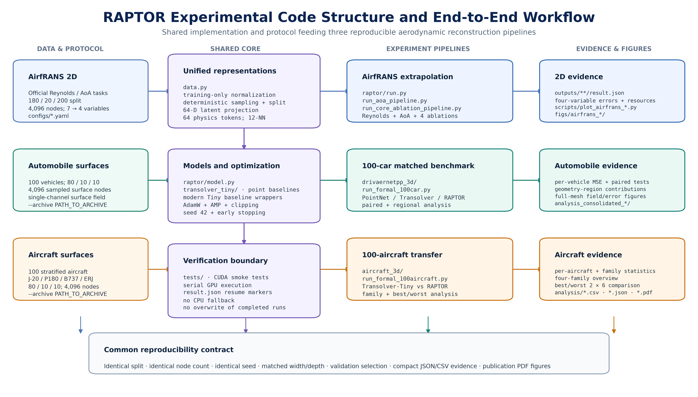

# RAPTOR

**RAPTOR: Resource-Aware Physics-Token Operator with Residual Local Adaptation
for Aerodynamic Field Reconstruction**

RAPTOR combines a Physics-Attention global backbone with a sparse local
`K`-nearest-neighbour residual adapter. Each adapter is controlled by a bounded
gate, `tanh(alpha)`, initialized at zero. The initialization therefore preserves
the unadapted backbone function, while training can progressively activate
node-level geometric correction.

This repository contains the implementation, matched baselines, configurations,
tests, analysis scripts, compact numerical evidence, and paper figures for:

- AirfRANS Reynolds-number and angle-of-attack extrapolation;
- core ablations of the local adapter and gate initialization;
- 100-vehicle three-dimensional surface-field reconstruction;
- 100-aircraft evaluation across J-20, P180, Boeing 737, and ERJ families.

Seed 42 is the reference accuracy run; the AirfRANS comparison additionally
uses training seeds 41 and 43 on the same fixed data split. The main experiments
use 4,096 sampled nodes, latent width 64, four operator blocks, 64 physics
tokens, and 12 nearest neighbours where the local adapter is enabled. Training
was performed with CUDA mixed precision on
an NVIDIA RTX 4050 Laptop GPU with 6,141 MiB of physical device memory. A
separate node-scaling profile evaluates 1,024--16,384 nodes without retraining.

The current manuscript source, compiled PDF, and supplementary material are
available under [`paper/`](paper/). The three-dimensional, capacity-control,
and neighbourhood-size accuracy experiments remain single-seed results.

## Main results

| Experiment | Reference | RAPTOR | Relative change |
|---|---:|---:|---:|
| AirfRANS Reynolds, macro relative L2 (seed 42) | Transolver-Tiny: 0.2280 | **0.2219** | -2.65% error |
| AirfRANS AoA, macro relative L2 (seed 42) | Transolver-Tiny: 0.3138 | **0.2969** | -5.37% error |
| 100-car surface $C_p$, standardized-space MSE | Transolver-Tiny: 0.145534 | **0.135684** | -6.77% error |
| 100-aircraft surface $C_p$, standardized-space MSE | Transolver-Tiny: 0.843596 | **0.771331** | -8.57% error |

The aircraft gain is not uniform: RAPTOR wins on 6 of 10 held-out aircraft and
improves the family mean for J-20, Boeing 737, and ERJ, while degrading P180.
See [docs/EXPERIMENTS.md](docs/EXPERIMENTS.md) for protocols, ablations,
resource measurements, evidence locations, and limitations.
The additional [three-seed AirfRANS evidence](outputs/airfrans_multiseed_41_43/README.md)
and [capacity-control and K-sensitivity evidence](outputs/capacity_knn_sensitivity/README.md)
include per-run metrics, epoch histories, training logs, aggregate tables,
and the corresponding run configurations.
For a path-by-path implementation index, see
[CODE_STRUCTURE.md](CODE_STRUCTURE.md).

## Experimental code structure



The diagram combines the repository structure with the end-to-end data,
training, evaluation, statistical-analysis, and visualization workflow. A PDF
version and its generation script are provided in `docs/`.

## Repository layout

```text
raptor/                    RAPTOR model and AirfRANS runner
transolver_tiny/           matched Physics-Attention baseline
transolver_plus_tiny/      matched Transolver++-Tiny adaptation
linearno_tiny/             matched LinearNO-Tiny adaptation
mono_tiny/                 matched MoNo-Tiny adaptation
configs/                   smoke, formal, and ablation configurations
tests/                     shape, gradient, equivalence, and runner tests
scripts/                   AirfRANS diagnostics, summaries, and figures
drivaernetpp_3d/           100-car training and analysis
aircraft_3d/               100-aircraft training and analysis
outputs/                   compact AirfRANS numerical evidence
outputs/node_scaling_profile/ measured latency, memory, and KNN evidence
outputs/airfrans_multiseed_41_43/ three-seed metrics and training logs
outputs/capacity_knn_sensitivity/ node-wise control and K-study evidence
figs/                      publication figures and editable framework source
paper_assets/              bibliography and reference-document utilities
paper/                     current LaTeX manuscript, figures, and compiled PDF
docs/                      experiment guide and implementation notes
vendor/SOURCES.md          exact upstream baseline provenance
```

Large raw datasets, generated caches, checkpoints, and prediction tensors are
excluded from version control. Selected training logs for the new experiments
are included so that reported epochs and losses can be inspected.

## Data preparation

The datasets are not redistributed by this repository.

1. Download AirfRANS from its official source and update `data_root` in the
   YAML files if it is not at
   `../AirfRANS_engineering_validation/data/AirfRANS/Dataset`.
2. Obtain the Mixed-3D benchmark used by the 3D experiments and pass its path
   through `--archive`. Automobile geometries are derived from DrivAerNet++,
   aircraft geometries are derived from OpenVSP, and the target is the surface
   pressure coefficient $C_p$ computed by a panel method at
   $\mathbf{v}_\infty=[1,0,0]$.
3. Adapted third-party baseline snapshots are included under `vendor/` together
   with their original license files. Their exact upstream revisions are listed
   in `vendor/SOURCES.md`.

## Environment

Python 3.10 or later and a CUDA-enabled PyTorch installation are required.
Install PyTorch for the local CUDA version, then run:

```powershell
python -m pip install -r requirements.txt
```

Formal runners raise an error when CUDA is unavailable and do not silently fall
back to CPU.

## Reproduction

Run commands from the repository root.

```powershell
# Tests
python -m pytest -q tests drivaernetpp_3d/test_formal_100car.py aircraft_3d/test_aircraft_runner.py

# AirfRANS RAPTOR
python -m raptor.run --config configs/formal.yaml
python -m raptor.run --config configs/aoa_raptor_formal.yaml

# Core AirfRANS ablations
python -s run_core_ablation_pipeline.py

# 100-car benchmark
python -s drivaernetpp_3d/run_formal_100car.py --archive PATH_TO_ARCHIVE \
  --output drivaernetpp_3d/outputs/formal_100car --points 4096 --knn 12 \
  --epochs 100 --patience 15 --seed 42

# 100-aircraft geometry evaluation
python -s aircraft_3d/run_formal_100aircraft.py --archive PATH_TO_ARCHIVE \
  --output aircraft_3d/outputs/formal_100aircraft --points 4096 --knn 12 \
  --epochs 100 --patience 15 --seed 42 --models transolver_tiny raptor

# Isolated node-scaling and exact CPU KNN profile
python scripts/profile_node_scaling.py --knn-repeats 10
```

Completed `result.json` files act as completion markers, allowing serial
pipelines to resume without overwriting finished results.

## Analysis and figures

```powershell
python drivaernetpp_3d/consolidate_100car_analysis.py
python aircraft_3d/analyze_aircraft_results.py
python aircraft_3d/make_four_aircraft_high_quality.py
python aircraft_3d/make_aircraft_best_worst_2x6.py
python scripts/profile_node_scaling.py --consolidate-only
```

Full-mesh 3D colors are visualization-only interpolations from matched 4,096
sampled nodes. Reported MSE values are evaluated on the sampled nodes.

## Scope and limitations

- AirfRANS and 3D tasks use different targets; their errors are not directly
  comparable across datasets.
- The 3D studies use controlled subsets of 100 objects with 80/10/10 splits.
- The AirfRANS model comparison uses three training seeds on one fixed split;
  the 3D, capacity-control, and K-sensitivity results use one seed. These do
  not establish universal per-sample improvement or hardware-independent speed
  superiority.
- The node-scaling profile is an implementation-level measurement on one RTX
  4050 Laptop GPU, not an accuracy--resource Pareto study.
- Exact CPU KNN construction is reported separately because its materialized
  pairwise-distance matrix has quadratic memory growth.

## Third-party code

Baseline names and upstream revisions are documented in
[vendor/SOURCES.md](vendor/SOURCES.md). Tiny models are matched-protocol
adaptations, not reproductions of the authors' full published configurations.
